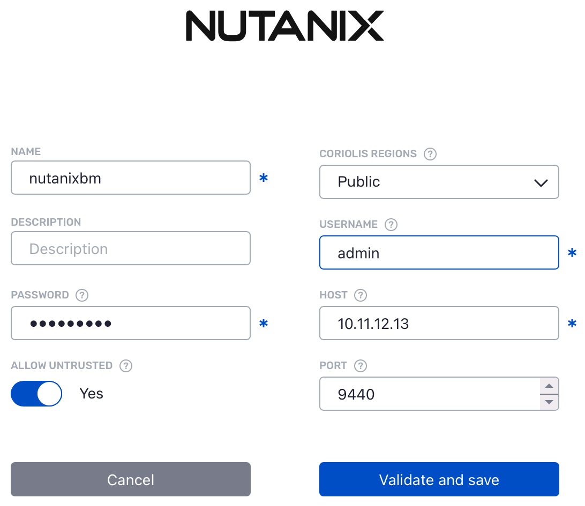

# Nutanix

**Coriolis** integrates the platform Plugin on the Appliance itself, this way there is no need for agents to be deployed on platforms to establish the communication between the platform and the Coriolis components. Using this type of architecture, **Coriolis** guarantees the connection to the supported platform set up to be used as either Source or Destination, as long as the requirements are met.

### Deployment requirements

The worker components of Coriolis need network access to the**Nutanix  Prism Central API**, as well as the **Nutanix iSCSI portal** used when retrieving disk data.

Note that Prism Central isn’t included by default in the latest community edition (2.1), it’s an optional component that must be enabled manually.

#### Version requirements

**Component**| **Version requirement**  
:---:|:---:  
Nutanix API| 4.0  
Nutanix AOS| >= 6.8  
Nutanix Prism Central| >= 7.3  

### Nutanix endpoint connection parameters

Coriolis requires the following connection parameters to access Nutanix Prism Central and migrate resources:

Each parameter represents:

  * name - an arbitrary user-defined name for this endpoint
  * username - Nutanix Prism Central username
  * password - Nutanix Prism Central password
  * host - Nutanix Prism Central host address
  * port - the port used by Nutanix Prism Central
  * allow untrusted - whether to allow untrusted TLS certificates when contacting Prism Central

### Nutanix platform specifics

Supported Actions: | Migration (CMaaS) Source/Destination – Replica (DRaaS) Source/Destination| Comments  
:---:|:---:|:---:  
Plugin identifier| **nutanix**|  Identifies the plugin. Used for the **–provider** CLI parameter  
Credentials needed| Nutanix Prism Central address and credentials.|    
Deployment requirements| Coriolis worker component(s) need network access to the Nutanix Prism Central API endpoint as well as the Nutanix iSCSI portal.| Coriolis deployment and environment connectivity requirements  
Instance identification scheme| By name or ID.| How instances to migrate/replicate are identified on a source cloud handled by this plugin  

### Nutanix as a source cloud

For more information on using Nutanix as a **source cloud** for Replica/Migration, please check the **[Nutanix as a source cloud](../nutanix/nutanix-as-a-source-cloud.md)** page.
