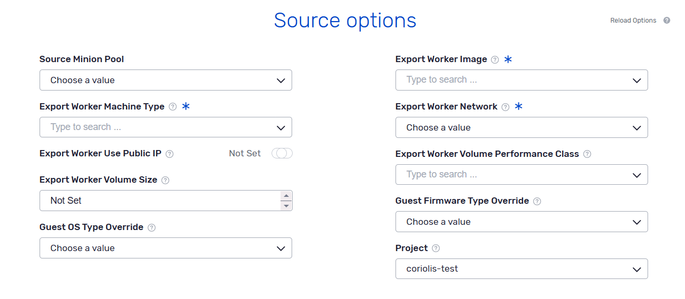
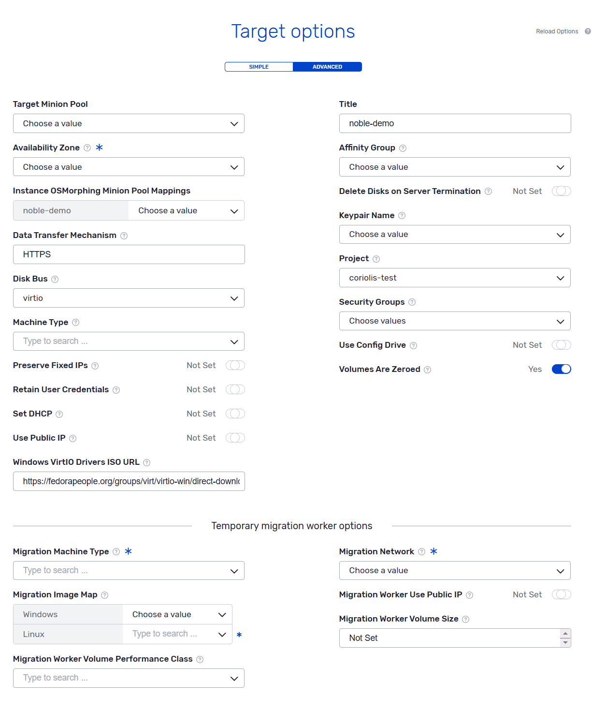
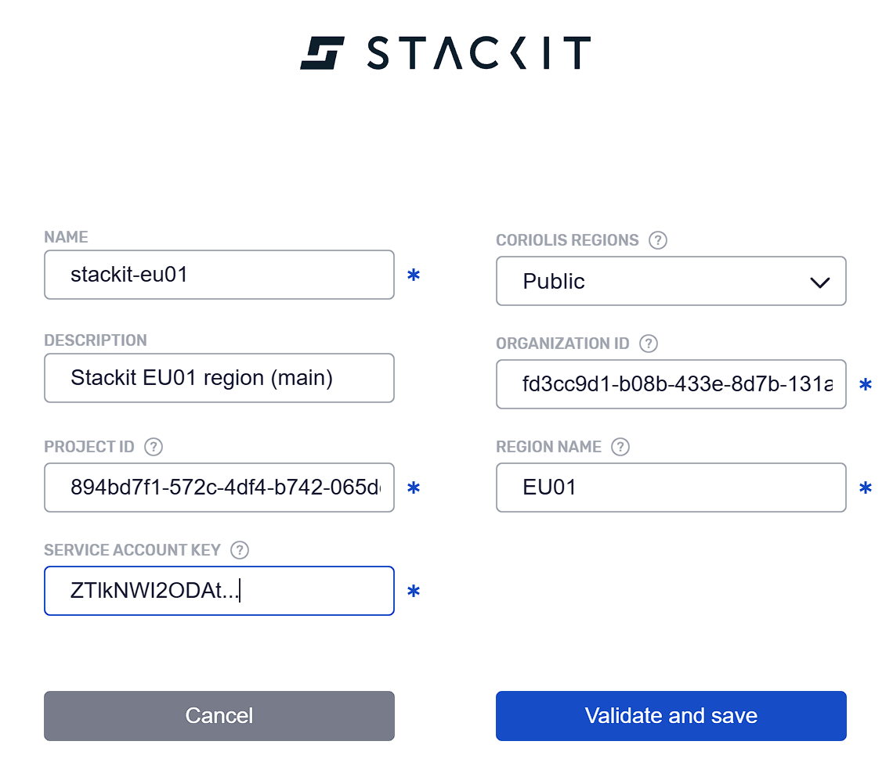

# STACKIT

**Coriolis** integrates the platform Plugin on the Appliance itself, this way there is no need for agents to be deployed on platforms to establish the communication between the platform and the Coriolis components. Using this type of architecture, **Coriolis** guarantees the connection to the supported platform set up to be used as either Source or Destination, as long as the requirements are met.

 

### Deployment requirements

The Coriolis appliance(s) need network access to the STACKIT APIs, as well as to the public IPs of the temporary VMs Coriolis will be creating during the migration process.

### Supported instances

STACKIT does not allow snapshotting ephemeral root disks, as such Coriolis can only migrate STACKIT instances that were booted from volume.

### STACKIT as a source cloud

For more information on using STACKIT as a **source cloud** for Replica/Migration, please check the **[STACKIT as a source cloud](../stackit/stackit-as-a-source-cloud.md)** page.

### STACKIT as a destination cloud

For more information on using STACKIT as a **destination cloud** for Replica/Migration, please check the **[STACKIT as a destination cloud](../stackit/stackit-as-a-destination-cloud.md)** page.

### STACKIT connection parameters

Coriolis requires the following connection parameters in order to acces STACKIT and migrate resources:



Each parameter represents:

  * name - an arbitrary user defined name for this endpoint
  * organization ID - the STACKIT organization ID
  * project ID - the STACKIT project ID
  * region name - the name of the STACKIT region
  * service account key - base64 encoded service account key

JSON form:

```json
{
  "organization_id": "fd3cc9d1-b08b-433e-8d7b-131a943e4feb",
  "project_id": "894bd7f1-572c-4df4-b742-065de62de403",
  "region_name": "EU01",
  "service_account_key": "ZTlkNWI2ODAtNWM3Yi00..."
}
```

Make sure that the specified service account has enough privileges to access, create and modify IAAS resources. For example, consider using the “Editor” role.

### STACKIT platform specifics

Supported Actions: | Migration (CMaaS) Source/Destination – Replica (DRaaS) Source/Destination| Comments  
---|---|---  
Plugin identifier| **STACKIT**|  Identifies the plugin. Used for the **–provider** CLI parameter  
Credentials needed| STACKIT organization, project, region and service account key.| The service account key is expected to be base64 encoded.  
Deployment requirements| Coriolis worker component(s) need network access to the STACKIT API endpoint.| Coriolis deployment and environment connectivity requirements  
Source disk export requirements| The VMs must be booted from volume and not use ephemeral root disks.| Requirements to use the replica export features.  
Instance identification scheme| By name or ID.| How instances to migrate/replicate are identified on a source cloud handled by this plugin  
Network identification scheme| By name or ID.| How the plugin identifies networks. Required for the **network_map** field of the **–destination-environment**  
Storage identification scheme| By the name or ID of the STACKIT storage performance class.| How the plugin identifies storage backends. Required for the **storage_map** field of the **–destination-environment**  

### STACKIT Coriolis plugin known issues and limitations

#### Automatic machine type selection for Windows instances

The STACKIT plugin cannot reliably select the machine type automatically when migrating Windows instances. STACKIT requires a Windows compatible machine type as documented here: <https://docs.stackit.cloud/products/compute-engine/server/basics/machine-types/>

STACKIT machine types returned by the API do not currently contain any Windows related labels or description keywords, as such the user must manually select one of the machine types documented as Windows compatible.

#### vTPM

STACKIT does not support vTPM devices, as such we cannot migrate VMs that use guest side encryption (e.g. BitLocker, LUKS). This may also affect other Windows hardening features that require a vTPM device.

#### Migrating instances that have ephemeral root disks

STACKIT instances that were not booted from volume and have ephemeral root disks cannot be migrated.

#### IPv6

STACKIT does not support IPv6 networks, as such any IPv6 addresses will be dropped.
