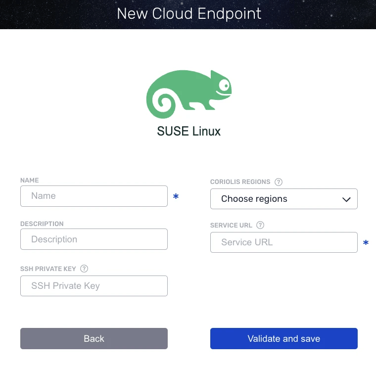

# SUSE Linux KVM

**Coriolis** integrates the platform Plugin on the Appliance itself, this way there is no need for agents to be deployed on platforms to establish the communication between the platform and the Coriolis components. Using this type of architecture, **Coriolis** guarantees the connection to the supported platform set up to be used as either Source or Destination, as long as the requirements are met.

## Endpoint connection parameters

A valid SSH private key is required for authentication when configuring the Coriolis endpoint. The corresponding public key must already be configured and authorized on the target Libvirt host **before** the endpoint can be used.

```{note}
It is recommended to use a dedicated service account for Libvirt endpoint access instead of the root account. The account should have sufficient **permissions** to access and manage Libvirt resources on the target host. On systems using group-based access control, this typically includes membership in the **libvirt and kvm groups**.
```

The SSH private key must be provided as part of the endpoint configuration and must be **base64-encoded** before submission. Only the SSH private key content should be encoded and passed to the endpoint.

If an SSH private key is provided in the connection info, it must be base64-encoded, and then the resulting string must be used as the value in the endpoint configuration.

```bash
base64 -w0 <path-to-private-key>
```



## SUSE Linux (KVM) as a destination cloud

For more information on using SUSE Linux (KVM) as a **destination cloud** for Replica/Migration, please check the **[SUSE Linux (KVM) as a destination cloud](../suse-linux-kvm/suse-linux-kvm-target-platform.md)** and **[SUSE Linux (KVM) as a destination cloud (SAP HANA SKU)](../suse-linux-kvm/suse-linux-kvm-sap-hana-target-platform.md)** pages.
